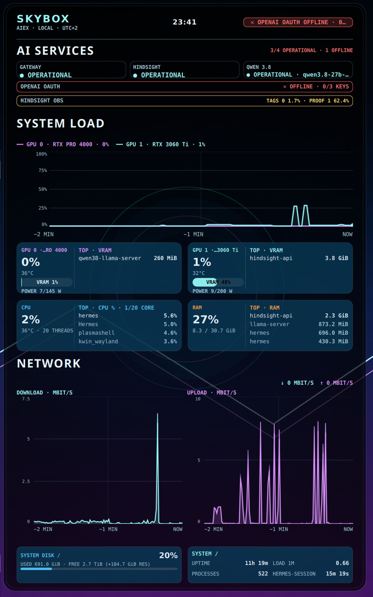

# Skybox Live Monitor



A compact, vertical real-time system dashboard for **KDE Plasma 6**. It is designed for a dedicated status display and shows CPU, GPU, VRAM, RAM, network throughput, disk space, and the most relevant active processes.

## Highlights

- CPU temperature display (like GPU card — no percentage, no progress bar)
- CPU and RAM cards label their thread count, so a per-process 52% next to an
  aggregate 4% CPU reading is unambiguous
- Independent telemetry for every NVIDIA GPU (0, 1, 2): utilization, temperature,
  VRAM, power and per-GPU compute processes (up to four largest consumers). The
  three GPU cards sit side by side in one row, with the live GPU model name and
  used VRAM in decimal GB always visible (the bar still shows percent filled;
  hover for exact MiB and total capacity). CPU and RAM share the row below
- Compact CPU and RAM process summaries (up to four largest consumers)
- Narrow cards show compact M/G memory figures so process names remain readable;
  hover a row for the full process name or the source reading (RAM: unrounded
  RSS in KiB; GPU: unrounded VRAM in MiB)
- GPU utilization is sampled every 500 ms via a lightweight `nvidia-smi` query;
  VRAM, temperature, power and process lists remain on their two-second cadence.
  Each GPU card shows **PEAK 30s**, the highest observed whole-GPU utilization
  in the rolling window, without holding the current percentage above idle.
  Missing/stale samples show `--`, and GPU UUID changes reset the window.
  The `hindsight-api` process carries the descriptive **EMBED / RERANK** role
  label (not an activity indicator or process-specific utilization measurement).
- Two-minute multi-GPU and network history charts, with one shared unit per
  network panel so axis and live value always agree; the panels use independent
  auto-scales, called out above the charts
- Header shows the age of the oldest successful CPU-process, GPU, or network
  poll (not the separately polled services, disk, or other system sensors)
- Disk usage in `df` semantics, including the filesystem reserve
- NVIDIA VRAM telemetry via `nvidia-smi`
- Longest completed Hermes run across the default and named profiles;
  assistant tool-call preambles and unfinished turns do not count as completion
  One unreadable profile does not discard other readings: a partial maximum is
  marked `≥` with a tooltip, and wholly unavailable timing appears as `--`.
- GPU and network history show gaps when readings fail or expire; unavailable
  network readings are labelled rather than repeated as new measurements
- Default-route interface detection supports gateway, VPN and PPP routes and
  validates the interface against local sysfs
- Service cards return to UNKNOWN on helper failures or after 60 seconds without
  a completed service poll; root disk capacity comes exclusively from the same
  statvfs reading as its used/free values
- Hindsight observation health: the card reports the quality signals that
  survive a bank rebuild — **MERGE** (share of observations that merged more than
  one raw fact; higher is better, because consolidation that never merges only
  copies raw facts), **BACKLOG** (raw facts that no observation references and that
  carry no `consolidated_at`; must stay 0 — the remaining unreferenced-but-processed
  facts are an upstream bookkeeping artifact), **SCOPE n Δ d** (distinct observation
  scopes and their trend — `observation_scopes` comes from the source fact's tags
  and consolidation only merges inside one scope), **DRIFT n** (scopes whose tag set
  only wraps an existing one: a tag permutation that splits a pool which already
  existed) and **LAG** (how far the newest observation trails the newest raw fact).
  **UNTAG p%** is the share of observations sitting in the single untagged catch-all
  scope, so the scope count is never read without the concentration behind it.
  Thresholds arrive in the helper payload. The color is healthy only when MERGE
  reaches its target, the backlog is 0, LAG is small and the scope count did not
  grow into tag drift between two valid polls — a rising count without new drift is
  a new topic and stays healthy; an unknown trend is muted. The tooltip adds the
  consolidation throughput of the payload's window (LAG alone stays near zero as
  long as any recent fact got consolidated), the all-time tagless/single-proof
  percentages and a deterministic sample audit of the unreferenced facts
  (`contents/code/hindsight_observation_health.py --orphan-audit` prints the sampled
  rows). The frozen pre-reset reference (1009 observations, 37.6% merges) was dropped
  in favour of a rolling merge trend of the card's own polls, which is memory only
  and restarts with the widget.
- Manual **Qwen 3.8 start/stop button** in the AI SERVICES header. It reads the
  real Qwen server unit (not the always-on gateway), treats a sleeping model as
  still ON, and calls the existing `~/.local/bin/qwen38-start` / `qwen38-stop`
  scripts for the Blackwell GPU handoff. The button is disabled while switching
  or when status is unknown; failures are visible on the button and explained
  in its tooltip. Stopping interrupts Qwen requests and restores Hindsight only;
  the decommissioned Nimble service is neither started nor probed.
  Boot settings and gateway configuration are not changed.
- Gateway query failures appear as UNKNOWN; OFFLINE requires a confirmed inactive
  or failed gateway state.
- No analytics uploads; local system probes and Hindsight HTTP health queries
- OpenAI OAuth availability is read through the local `hermes auth list` command; only aggregate counts reach the widget (polled once per minute; an elapsed cooldown shown as `(ready to retry)` counts as available, matching the Hermes credential pool)

## Requirements

- KDE Plasma 6 (Wayland or X11), including the Plasma executable data engine
- Python 3 for bundled helpers; Linux `/proc` and `/sys`, `ip`, and standard shell utilities
- NVIDIA GPU and `nvidia-smi` for GPU/VRAM metrics (other panels still work without it)

## Install

```bash
kpackagetool6 --type Plasma/Applet --install .
```

To update an existing installation:

```bash
kpackagetool6 --type Plasma/Applet --upgrade .
```

Then add **Skybox Vertical System Dashboard** from Plasma's *Add Widgets* dialog.

After upgrading, remove and re-add the widget if Plasma still uses the old code. If necessary, restart the shell from the user session:

```bash
systemctl --user restart plasma-plasmashell.service
```

This briefly restarts the desktop shell; save ongoing desktop work first. No global cache deletion is required for installation.

## Optional AI panels and data sources

The hardware panels work independently of the AI integrations. Missing tools or endpoints appear as unavailable/error states; a failed credential query must not be interpreted as a real zero count.

| Helper | Data source / configuration |
|---|---|
| [hermes_max_think.py](contents/code/hermes_max_think.py) | Local SQLite history under `~/.hermes`, including named profiles; standalone `--root` / `--db` overrides |
| [hermes_openai_keys.py](contents/code/hermes_openai_keys.py) | `hermes auth list` via PATH or `~/.local/bin/hermes`; inherits `HERMES_HOME`; `HERMES_MONITOR_PROFILE` explicitly selects a named profile |
| [ai_services_status.py](contents/code/ai_services_status.py) | User unit `hermes-gateway.service`, fixed `http://127.0.0.1:9177/health`, and aggregate OAuth counts |
| [hindsight_observation_health.py](contents/code/hindsight_observation_health.py) | `HINDSIGHT_API_URL` (default `http://127.0.0.1:9177`) and `HINDSIGHT_HEALTH_BANK` (default `hermes`) |

Environment overrides must be visible to the Plasma shell process, not just a terminal running a helper. `HINDSIGHT_API_URL` affects observation health only; the service status helper retains its fixed loopback endpoint. Overriding the API URL can cause remote HTTP requests. The observation helper reads paginated memory and scope data without invoking an LLM, and its migration timestamp/baselines are specific to the original `hermes` bank; reassess them for another installation.

The widget needs no embedded API key, but Hermes OAuth monitoring requires an existing local auth store. Credential identifiers and labels are not shown by the helper. Keep local services and their access policies under your own control.

QML polling and panel integration live in [contents/ui/main.qml](contents/ui/main.qml); reusable chart calculations live in [monitor_logic.js](contents/code/monitor_logic.js).

## Tests

Install pytest in a project-local environment if it is unavailable. The helper tests use local fixtures/mocks; they do not prove that a widget renders correctly in your desktop session.

```bash
python3 -m pytest -q
node --check contents/code/monitor_logic.js
qmllint contents/ui/main.qml contents/ui/QwenControl.qml
```

The Python regression suite is the main test suite and covers GPU telemetry error contracts, process parsing, and QML integration. `qmllint` may report unresolved Plasma types when run outside Plasma's import environment; run the widget inside Plasma as the final integration check.

## License

MIT. See [LICENSE](LICENSE).
